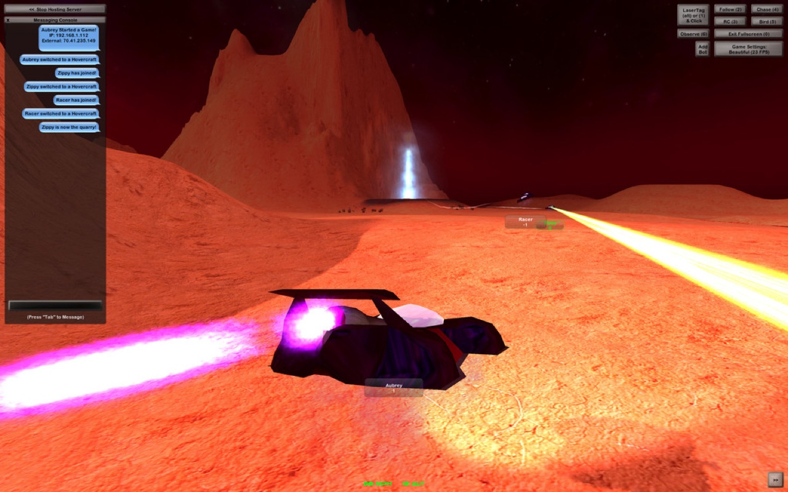
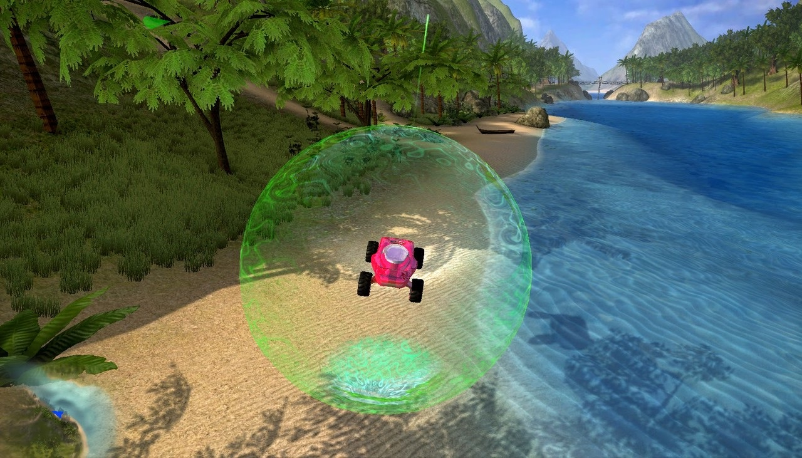
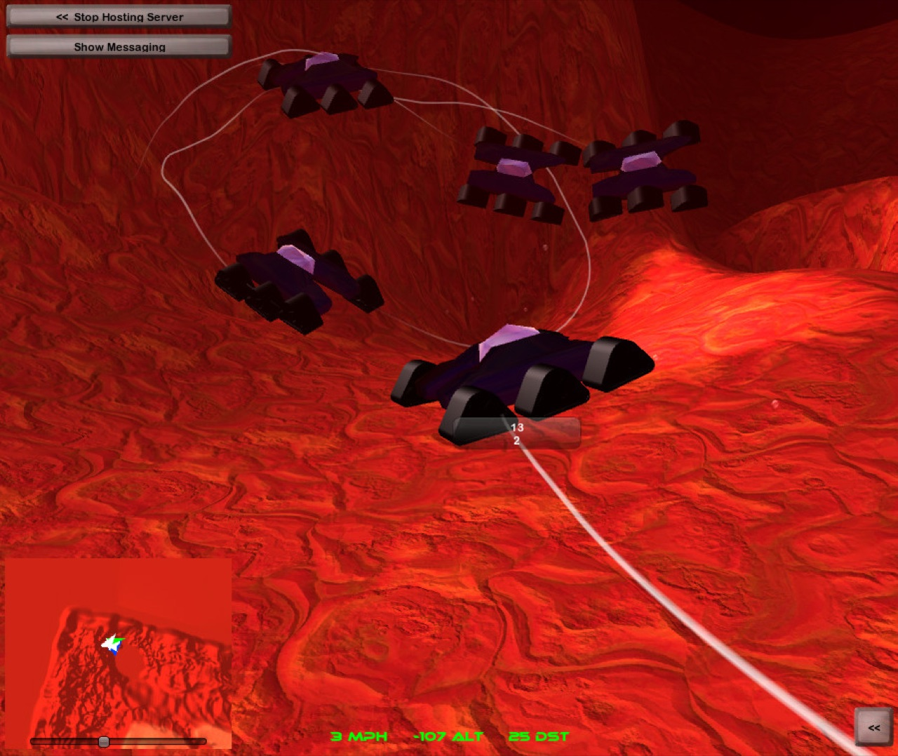
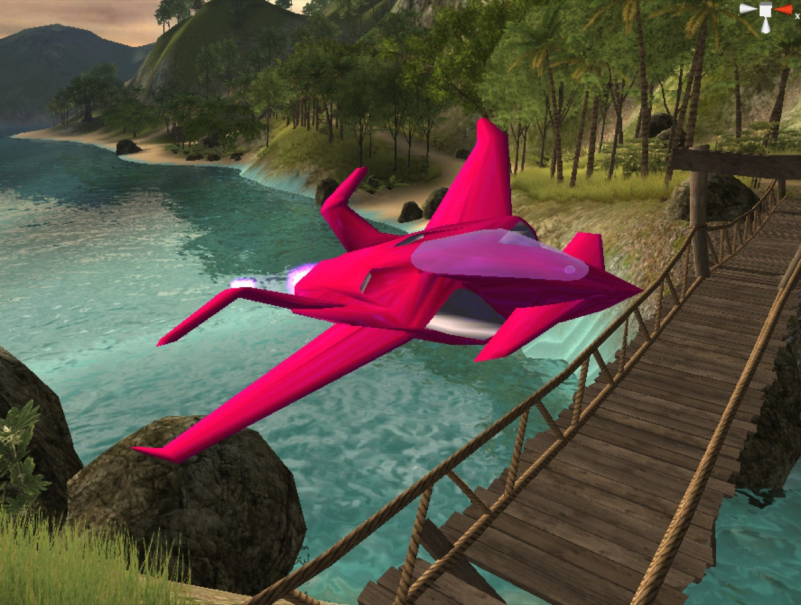
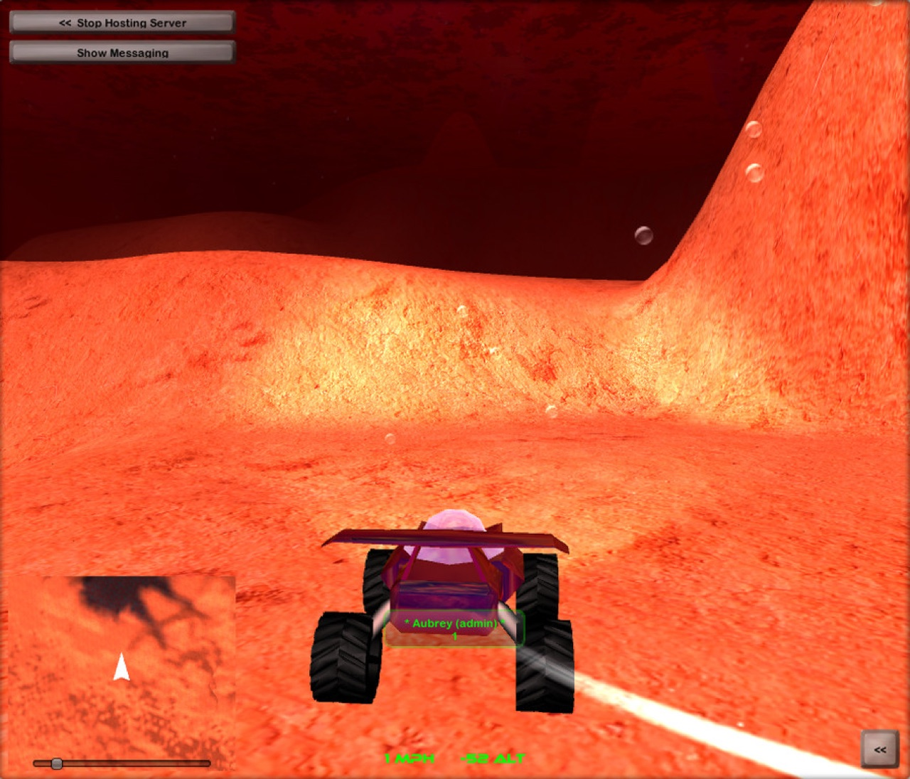
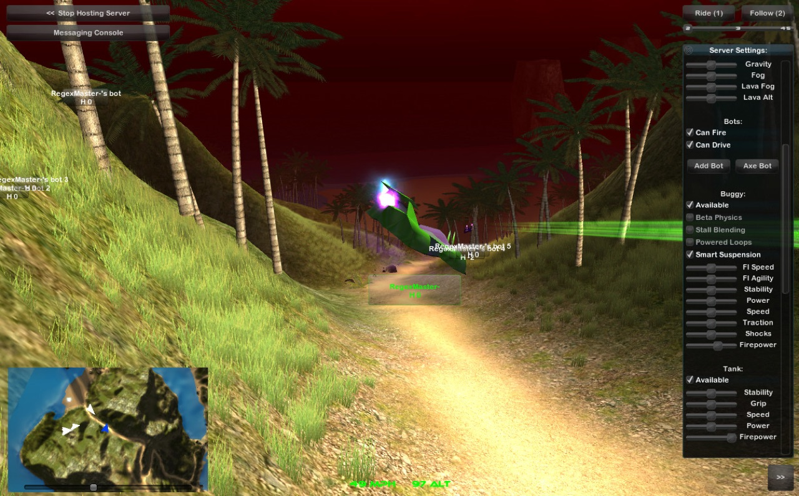

  

<h1 align="center">Mars Explorer</h1>

<b>Freeform vehicular adventure.</b> Flying cars, giant volcanoes, and laser tag with your friends.

Mars Explorer is a multiplayer sci-fi sandbox that Aubrey Falconer built in 2008, at 18, from the forests of Northern Idaho. Players drove, hovered and flew across Martian worlds, chased each other through laser tag, and built worlds and vehicles of their own. This repository holds the full Unity source of the game.

  
  
  
  
  
  

## The game

- **Vehicles.** A buggy, a hovercraft, a tank and a jet, with lasers for combat.
- **Worlds.** The game calls its maps "Whirlds." Classics include Freestyle, Lava Racer, Foxholes, FortBoxy, Levitashia, Unity Island and Seb's Sky Monster.
- **Mods.** Players designed custom maps and vehicles, and a thriving community kept new ones coming for years.

## Legacy

- Over 1 million total players.
- More than 70,000 registered identities on the community forum.
- The most popular macOS Dashboard widget game in the world for over a month.
- A Special Mention in the 2008 Unity Awards.

## The community

Mars Explorer grew into a community of thousands of creators and hundreds of thousands of explorers. Aubrey described it as "a universally-accessible virtual reality where all are welcome to gather, play, and create." Hundreds of teens found a passion for engineering, programming and industrial design there, and many turned it into a career.

## Open source and retirement

Aubrey open sourced the game here in February 2015, and a community contributor ported it to Unity 5 a month later. Mars Explorer retired as an active project in June 2015, and Mars Explorer Mobile was relisted free on the iOS App Store.

## Opening the project

| Folder | Unity version |
| --- | --- |
| `unity/` | 4.6.1f1, the original game |
| `Mars Explorer - Unity 5 Compatibility Fix/` | 5.0.0f4, the community Unity 5 port ([#1](https://github.com/terran-labs/unity3d-marsxplr/pull/1)) |

Open either folder with the matching Unity editor. Scenes load in the order `Init`, `Lobby`, `InitGame`, `Game`, under `Assets/_Scenes`. Current Unity editors no longer compile UnityScript, which most of the scripts use, so a modern editor needs porting work.

## Community port

[VIA256/unity3d-marsxplr](https://github.com/VIA256/unity3d-marsxplr) is an independent community effort, built on Unity 6, to run Mars Explorer on WebGL, current Macs and other new platforms. This project does not endorse or maintain it; send questions and contributions to that repository.

## Related

- [Syn3h backstory](https://www.syn3h.com/backstory.html): Mars Explorer and its spiritual successor, Syn3h.
- [Requiem](https://web.archive.org/web/20200223170918/http://marsxplr.com/view-14370): Aubrey's 2015 farewell to the community.
- [marsxplr.com](https://web.archive.org/web/2020/http://marsxplr.com/), archived.

## License

[MIT](LICENSE). Copyright (c) 2015 Aubrey Falconer.
